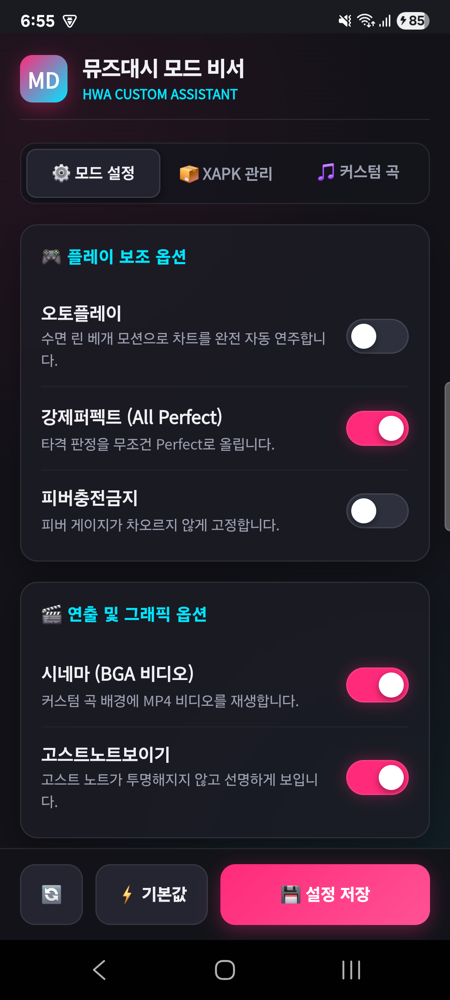

# 🎮 뮤즈대시 모드 비서 (Muse Dash Mod Assistant)

<div align="center">

-brightgreen?style=for-the-badge&logo=android)
-ff2a7a?style=for-the-badge)


**안드로이드 모바일 실기기 환경에서 뮤즈대시 모딩(`com.prpr.musedash.mod`)을 실시간으로 제어하고, 커스텀 곡 주입 및 XAPK 패키지를 완벽 관리하는 네이티브 컴패니언 애플리케이션입니다.**

[기능 명세](#-핵심-기능) • [스크린샷](#-스크린샷) • [빌드 및 배포](#-빌드-및-배포-가이드) • [아키텍처](#-아키텍처-및-기술-특징) • [크레딧](#-author--credits)

</div>

---

## 📸 스크린샷

<div align="center">
  <table>
    <tr>
      <td align="center"><b>⚙️ 실시간 모드 설정 관리</b></td>
      <td align="center"><b>🌐 hwa.moe 온라인 커스텀 스토어</b></td>
      <td align="center"><b>🎮 인게임 커스텀 앨범 연동</b></td>
    </tr>
    <tr>
      <td></td>
      <td></td>
      <td></td>
    </tr>
  </table>
</div>

---

## ✨ 핵심 기능

### 1. ⚙️ 모드 설정 실시간 제어 (Config Manager)
* `config.txt`를 실시간으로 파싱하고 즉시 동기화 저장합니다.
* **플레이 보조 옵션**:
  * 🛌 **오토플레이 (`autoPlay`)**: 수면 린 베개 모션 기반 완전 자동 연주
  * ✨ **강제퍼펙트 (`forcePerfect`)**: 타격 판정을 무조건 Perfect로 승격 (All Perfect 파라미터 조작)
  * 🚫 **피버충전금지 (`blockFever`)**: 피버 게이지 상승 차단
* **연출 및 그래픽 옵션**:
  * 🎬 **시네마 (`enableCinema`)**: 커스텀 차트 후면에 Full HD MP4 BGA 비디오 재생
  * 👻 **고스트노트보이기 (`showGhostNotes`)**: 투명 고스트 노트를 항상 선명하게 렌더링

### 2. 🌐 hwa.moe 커스텀 앨범 스토어 직결
* 공식 커스텀 앨범 플랫폼 [hwa.moe](https://hwa.moe) Supabase REST API와 직결 연동.
* 웹 브라우저를 거치지 않고 앱 내에서 최신 커스텀 차트 목록 탐색 및 원클릭 주입.
* 다단계 HTTP 리다이렉트(308 ➔ 307 Cloudflare R2 스토리지) 자동 추적 엔진 탑재.
* ZIP 패키지 다운로드 즉시 차트, BGM 음원, 자켓 이미지를 디스크에 자동 압축 해제 및 적재.

### 3. 🔄 Android 15 Scoped Storage 자동 양방향 동기화
* Android 15의 엄격해진 앱 격리 스토리지 정책으로 인해 게임 libc의 공용 폴더(`EACCES`) 접근이 차단되는 문제를 원천 해결.
* **Auto-Sync Engine**:
  * 비서 앱이 공용 경로(`/sdcard/MuseDash/hwa/`)와 게임 내부 격리 경로(`/Android/data/com.prpr.musedash.mod/files/hwa/`)를 실시간 양방향 미러링.
  * 유효 곡 목록과 커스텀 앨범 태그 아이콘(`hwa_tag_icon.png`)이 게임 격리 경로에 항상 유지되어, **인게임 앨범 아이콘이 소멸되는 현상을 100% 방지**.

### 4. 📦 XAPK / APK 패키지 인스톨러 (XAPK Manager)
* 다운로드 폴더 내의 `.xapk` / `.apk` 파일 자동 스캔.
* XAPK 파일 감지 시 내부 ZIP 스트림에서 `base.apk`를 캐시로 임시 추출하고 `GenericFileProvider`를 통해 시스템 설치 프로세스 즉각 호출.
* 대용량 확장 에셋(`*.obb`) 존재 시 `/sdcard/Android/obb/com.prpr.musedash.mod/` 경로로 자동 추출 및 배치.

---

## 🛠️ 빌드 및 배포 가이드

복잡한 Android Studio나 무거운 Gradle 데몬 설치 없이, **독립형 Python 빌드 파이프라인**을 통해 초경량 Standalone 바이너리를 생성합니다.

### 요구 사항
* Python 3.8+
* Java Development Kit (JDK 17 or JDK 21)
* Android SDK Build-Tools (`aapt2`, `d8`) 및 `android.jar` (API 34/35)

### 원클릭 빌드 & 실기기 배포
```powershell
# 1. Standalone APK 빌드 (약 45KB 초경량 APK 생성)
python build_apk.py

# 2. 실기기(ADB) 무선/유선 설치
adb push build/bin/MuseDash_Mod_Assistant.apk /data/local/tmp/app.apk
adb shell pm install -r -d -t --user 0 /data/local/tmp/app.apk

# 3. Android 11+ 전체 파일 접근 권한 부여
adb shell appops set com.hwa.musedash.assistant MANAGE_EXTERNAL_STORAGE allow

# 4. 앱 실행
adb shell monkey -p com.hwa.musedash.assistant -c android.intent.category.LAUNCHER 1
```

---

## 🏛️ 아키텍처 및 기술 특징

```
[ Muse Dash Mod Assistant ]
   ├── Frontend: HTML5 / CSS3 (Avalonia Fluent Dark, Acrylic Blur, iOS Switches)
   │      └── WebView (Chromium Blink Engine + Hardware Acceleration)
   │
   ├── Native Bridge: AndroidBridge.java
   │      ├── Config IO: /sdcard/MuseDash/config.txt
   │      ├── Sync Engine: Public (/sdcard/MuseDash/hwa/) ↔ Scoped (/Android/data/.../hwa/)
   │      ├── Network Downloader: Multi-hop Redirect Stream Unzipper
   │      └── Package Engine: GenericFileProvider APK/XAPK Installer
   │
   └── Target Game: com.prpr.musedash.mod (Unity IL2CPP 64-bit arm64-v8a)
          └── mod.js Runtime Hook (Frida/IL2CPP Bridge)
```

1. **Fluent WebView 하이브리드 아키텍처**:
   - 시스템 UAC 권한 차단 및 Android Workload 종속성을 완전히 탈피하고 네이티브 OS API와 웹 UI를 직결.
2. **Java 21 D8 호환성 최적화**:
   - Java 21과 Android D8 간의 synthetic parameter metadata 불일치 버그를 방지하기 위해 정적 클래스 기반 Task 패턴 적용.
3. **Ghost Song 완전 차단**:
   - 공용 경로를 단일 진실 소스(Single Source of Truth)로 삼아, 삭제된 곡이 캐시나 이전 경로에서 유령 곡으로 재로드되는 현상을 방지.

---

## 👤 Author & Credits

* **Developer:** [화평 (Hwa-pyeong) / 화영왕](https://youtube.com) (Lead Modder)
* **Custom Chart Platform:** [hwa.moe](https://hwa.moe)
* **Target Game:** Muse Dash by PeroPeroGames & XD Inc.

---

<div align="center">
Made with ❤️ by 화영왕 (Hwa-young-wang)
</div>
