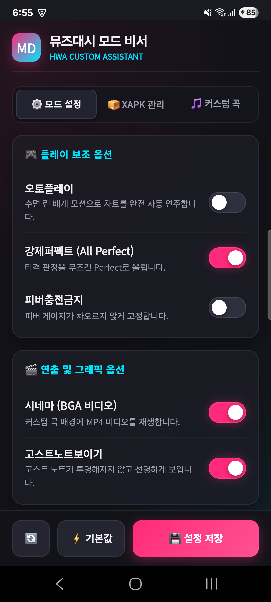
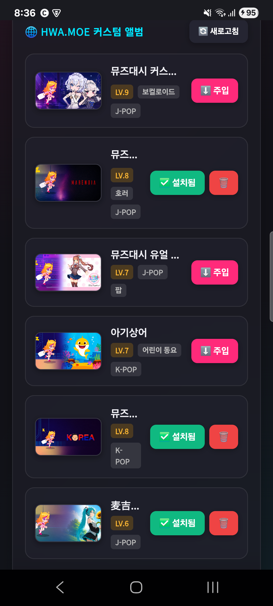

# 🎮 뮤즈대시 모드 비서 (Muse Dash Mod Assistant)

<div align="center">

-brightgreen?style=for-the-badge&logo=android)
-ff2a7a?style=for-the-badge)


**안드로이드 모바일 실기기 환경에서 뮤즈대시 모딩(`com.prpr.musedash.mod`)을 실시간으로 제어하고, 커스텀 곡 주입 및 XAPK 패키지를 완벽 관리하는 네이티브 컴패니언 애플리케이션입니다.**

[기능 명세](#-핵심-기능) • [스크린샷](#-스크린샷) • [빌드 및 배포](#-빌드-및-배포-가이드) • [아키텍처](#-아키텍처-및-기술-특징) • [크레딧](#-author--credits)

**[📥 최신 APK 다운로드](https://github.com/magjangin/muse-dash-app-support-tool/releases/latest)**

</div>

---

## 📥 설치 및 문서

1. [Releases](https://github.com/magjangin/muse-dash-app-support-tool/releases/latest)에서 APK를 받아 설치합니다.
2. 앱에서 **모든 파일에 대한 접근**을 허용합니다.
3. Android 11 이상이면 설정 탭 맨 위에 🔗 **게임 연동됨**이 뜨는지 확인합니다. ⚠️가 뜨면 PC에서 adb 명령을 한 번 실행해야 합니다.

| 문서 | 내용 |
|---|---|
| [설치 가이드](docs/INSTALL.md) | APK 설치, 권한, 게임 설정 연동(adb 1회), mod.js 최신화 |
| [사용 설명서](docs/USAGE.md) | 탭별 기능, 토글과 `config.txt` 키, 파일 위치 |
| [문제 해결](docs/TROUBLESHOOTING.md) | 설정 미반영, 곡 미표시, adb 버전 충돌 등 |
| [변경 이력](CHANGELOG.md) | 버전별 변경 사항 |

---

## 📸 스크린샷

<div align="center">
  <table>
    <tr>
      <td align="center"><b>⚙️ 실시간 모드 설정 관리</b></td>
      <td align="center"><b>🌐 hwa.moe 온라인 커스텀 스토어</b></td>
      <td align="center"><b>🎮 인게임 커스텀 앨범 연동</b></td>
    </tr>
    <tr>
      <td></td>
      <td></td>
      <td></td>
    </tr>
  </table>
</div>

---

## ✨ 핵심 기능

### 1. ⚙️ 모드 설정 실시간 제어 (Config Manager)
* `config.txt`를 실시간으로 파싱하고, 토글을 바꾸는 즉시 저장합니다. 게임은 플레이 중에도 1초 안에 반영합니다.
* 설정 탭 맨 위에 게임 연동 상태(🔗 / ⚠️)를 표시합니다. 자세한 내용은 [설치 가이드](docs/INSTALL.md#3-게임-설정-연동-android-11-이상-기기당-1회)를 보세요.
* **플레이 보조 옵션**:
  * 🛌 **오토플레이 (`autoPlay`)**: 수면 린 베개 모션 기반 완전 자동 연주
  * ✨ **강제퍼펙트 (`forcePerfect`)**: 타격 판정을 무조건 Perfect로 승격 (All Perfect 파라미터 조작)
  * 🚫 **피버충전금지 (`blockFever`)**: 피버 게이지 상승 차단
* **연출 및 그래픽 옵션**:
  * 🎬 **시네마 (`enableCinema`)**: 커스텀 차트 후면에 Full HD MP4 BGA 비디오 재생
  * 👻 **고스트노트보이기 (`showGhostNotes`)**: 투명 고스트 노트를 항상 선명하게 렌더링

### 2. 🌐 hwa.moe 커스텀 앨범 스토어 직결
* 공식 커스텀 앨범 플랫폼 [hwa.moe](https://hwa.moe) Supabase REST API와 직결 연동.
* 웹 브라우저를 거치지 않고 앱 내에서 최신 커스텀 차트 목록 탐색 및 원클릭 주입.
* 다단계 HTTP 리다이렉트(308 ➔ 307 Cloudflare R2 스토리지) 자동 추적 엔진 탑재.
* ZIP 패키지 다운로드 즉시 차트, BGM 음원, 자켓 이미지를 디스크에 자동 압축 해제 및 적재.

### 3. 🔄 Android 11+ 곡 전달 (SongProvider)
* Android 11 이상에서는 비서 앱이 게임의 `Android/data` 폴더에 쓸 수 없고, 게임도 비서 앱이 받은 공용 파일을 읽을 수 없습니다.
* 비서 앱이 `/sdcard/MuseDash/hwa/`를 **읽기 전용 ContentProvider로 게임에게만** 열어 둡니다.
* 게임이 시작될 때 모드(`mod.js`)가 목록을 받아 새 파일만 게임 전용 폴더로 복사하고, 비서 앱에서 지운 곡은 게임 폴더에서도 지웁니다.
* 곡 가져오기를 지원하는 [muse-dash-phone](https://github.com/magjangin/muse-dash-phone) `mod.js`가 필요합니다. 자세한 내용은 [사용 설명서](docs/USAGE.md#곡이-게임에-들어가는-방식)를 보세요.

### 4. 📦 XAPK / APK 패키지 인스톨러 (XAPK Manager)
* 다운로드 폴더 내의 `.xapk` / `.apk` 파일 자동 스캔.
* XAPK 파일 감지 시 내부 ZIP 스트림에서 `base.apk`를 캐시로 임시 추출하고 `GenericFileProvider`를 통해 시스템 설치 프로세스 즉각 호출.
* 대용량 확장 에셋(`*.obb`) 존재 시 `/sdcard/Android/obb/com.prpr.musedash.mod/` 경로로 자동 추출 및 배치.

---

## 🛠️ 빌드 및 배포 가이드

v2.0.0부터 일반 **Gradle 프로젝트**입니다. Android Studio로 폴더를 열어도 되고, 명령줄로도 빌드됩니다.

### 요구 사항
* JDK 17 이상 (21 권장)
* Android SDK: `platforms;android-36`, `build-tools;36.1.0`, `platform-tools` — Android Studio가 깔아 주거나 `sdkmanager`로 설치
* `local.properties`에 SDK 위치 (`sdk.dir=...`, Android Studio가 자동 생성) 또는 환경 변수 `ANDROID_HOME`
* Gradle은 래퍼(`gradlew`)가 받아 옵니다 (Gradle 9.9.1, AGP 9.5.1)

### 빌드 & 테스트
```powershell
# 단위 테스트(JVM) + lint + 배포용 APK
.\gradlew.bat testDebugUnitTest lintDebug assembleRelease
# 산출물: app/build/outputs/apk/release/app-release.apk (약 47KB)

# 실기기 계측 테스트 (권한·데이터를 지우지 않도록 Gradle의 connectedAndroidTest 대신 직접 설치해 실행)
.\gradlew.bat assembleDebug assembleDebugAndroidTest
adb install -r -t app/build/outputs/apk/debug/app-debug.apk
adb install -r -t app/build/outputs/apk/androidTest/debug/app-debug-androidTest.apk
adb shell am instrument -w com.hwa.musedash.assistant.test/androidx.test.runner.AndroidJUnitRunner
adb uninstall com.hwa.musedash.assistant.test
```

### 실기기 배포
```powershell
adb install -r app/build/outputs/apk/release/app-release.apk

# Android 11+ 전체 파일 접근 권한 부여
adb shell appops set com.hwa.musedash.assistant MANAGE_EXTERNAL_STORAGE allow

# (Android 11+, 기기당 1회) 게임이 공용 config.txt를 읽을 수 있게 소유 앱 지정
adb shell "content update --uri content://media/external/file --bind owner_package_name:s:com.prpr.musedash.mod --where \"_data='/storage/emulated/0/MuseDash/config.txt'\""
```

### 서명
배포 APK는 v1.0.x와 같은 키(`signing/uber-debug.keystore`, uber-apk-signer에 들어 있던 공개 debug 키)로 서명합니다. 그래야 기존 사용자가 앱을 지우지 않고 업데이트할 수 있습니다. 키를 바꾸면 사용자는 앱을 지우고 다시 설치해야 합니다.

### 릴리스 만들기
```powershell
# 1. app/build.gradle.kts의 versionCode / versionName을 올리고 CHANGELOG.md 작성
# 2. 빌드 후 버전이 붙은 이름으로 GitHub 릴리스에 업로드
.\gradlew.bat testDebugUnitTest lintDebug assembleRelease
Copy-Item app\build\outputs\apk\release\app-release.apk MuseDash_Mod_Assistant-v2.0.0.apk
gh release create v2.0.0 MuseDash_Mod_Assistant-v2.0.0.apk --title "v2.0.0" --notes-file <릴리스 노트 파일>
```

---

## 🏛️ 아키텍처

```
app/src/main/
 ├── assets/                 화면 (WebView): index.html · app.css · app.js
 └── java/com/hwa/musedash/assistant/
      ├── MainActivity       WebView, 자켓 이미지 주소(https://assistant.local/cover/<곡>)
      ├── AndroidBridge      window.AndroidBridge — JSON 변환과 백그라운드 스레드만 담당
      ├── SongProvider       /MuseDash/hwa 를 게임에게만 읽기 전용으로 공개 (mod.js가 시작 시 가져감)
      ├── GenericFileProvider  시스템 설치 화면에 APK 넘기기
      ├── config/            ModConfig(config.txt 규칙, 순수 Java) · ConfigRepository(파일·소유자)
      ├── songs/             SongLibrary(목록·삭제·자켓) · SongDownloader(hwa.moe ZIP) · SafePaths
      ├── xapk/              XapkRules(OBB 위치 규칙) · PackageInstaller(XAPK 풀기·설치)
      └── records/           RecordResetQueue(기록 초기화 예약)
app/src/test/                JVM 단위 테스트 (config 규칙, ZIP 경로 안전, XAPK 규칙 등)
app/src/androidTest/         실기기 테스트 (SongProvider 규약, config 소유자 유지, 화면)
```

- 앱 본체는 외부 라이브러리 없이 Android SDK만 씁니다. 테스트 라이브러리는 APK에 들어가지 않습니다.
- 서버(hwa.moe)·파일에서 온 문자열은 화면에 `textContent`로만 넣습니다 (HTML로 해석되지 않음).
- 자세한 설계 이유와 실패 기록은 [AGENTS.md](AGENTS.md)에 있습니다.

---

## 👤 Author & Credits

* **Developer:** [화평 (Hwa-pyeong) / 화영왕](https://youtube.com) (Lead Modder)
* **Custom Chart Platform:** [hwa.moe](https://hwa.moe)
* **Target Game:** Muse Dash by PeroPeroGames & XD Inc.

---

<div align="center">
Made with ❤️ by 화영왕 (Hwa-young-wang)
</div>
